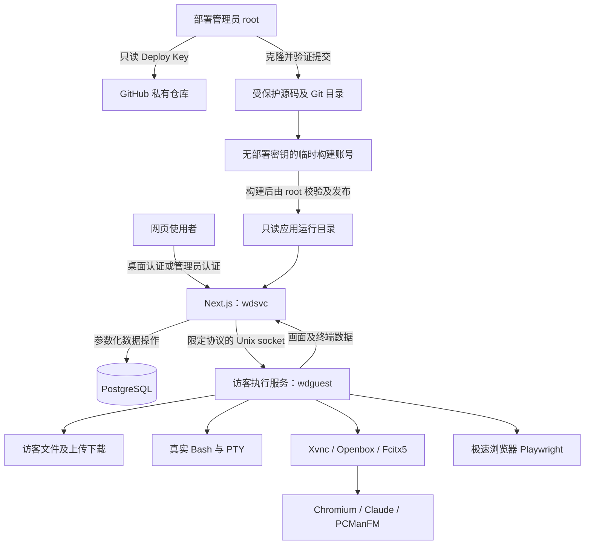

# WebDesktop 私有部署与访客隔离：第一阶段审查及实施方案

审查日期：2026-10-19。目标：新的 Debian 12、64 位 VPS。

审查基线：本地 `5922e1408de91e56771f1ea0bf94a9df1b7028cd`，以及工作区中上一轮对 `src/lib/sys.ts` 的修改（取消生成欢迎文件和示例图片）。本方案保留该修改。

**状态：第一阶段设计已获认可；第二阶段已在独立开发分支实现，等待验收。第三至第五阶段尚未实施。本文不是已经完成运行时隔离的声明，也不是可以直接在旧生产机执行的迁移脚本。**

## 1. 结论与证据边界

现有部署把 Next.js、真实文件接口、交互终端、图形程序放在同一个 Linux 账号下。桌面认证能限制谁可以进入桌面，却不能限制进入桌面后程序拥有的 Linux 权限。当前架构不满足任务书的源码及凭据隔离目标。

审查覆盖任务书点名的安装、服务、真实文件接口、终端、图形程序、浏览器、监视器、剪贴板代码，并扩展到数据库云盘、认证、共享窗口快照、CI 和现有恢复测试。此次没有读取生产机配置、访问生产数据库或操作 VPS。

2026-10-19 打开的 GitHub 仓库页面将 `isAliceYoung/fa` 标为 Public。以下按未来私有仓库设计；变更仓库可见性需要仓库管理员操作，已被第三方复制的历史公开源码无法通过 VPS 权限设置收回。可见性也不能证明仓库中是否曾有敏感信息，本轮没有进行完整历史泄密审计。

不向浏览器交付私有服务端源码；浏览器正常获取的前端 JavaScript、CSS 和 noVNC 静态资源仍然可见。不能承诺隐藏这些客户端资源。

## 2. 当前审查发现

以下是源代码推导，尚未在真实 VPS 上复现攻击。

| 优先级 | 位置 | 当前行为及影响 | 处理方案 |
|---|---|---|---|
| 必须先修复 | `scripts/common.sh` 的 `configure()`、部署模板 | 应用位于运行账号家目录，Next.js、访客进程共用账号。sudo 安装还可能复用具备 sudo 权限的原登录账号；这不等于已证实可无密码 sudo，但不能作为专用受限账号。 | 使用独立的服务、访客和临时构建账号，拒绝复用管理员登录账号。 |
| 必须先修复 | `src/app/api/sys/fs/route.ts` | 桌面认证后直接以服务账号读取或写入请求指定的路径；`resolveP()` 仅解析路径。 | 迁移实际文件操作到访客执行层；后端只鉴权及转发。 |
| 必须先修复 | `sys/raw`、`sys/download`、`sys/upload` | 原始文件、流式下载、Python ZIP 和分块上传仍以服务账号运行；上传路径和临时文件没有统一权限边界。 | 全部迁移，包含 ZIP 子进程、上传临时文件、放弃上传及目录创建。 |
| 必须先修复 | `src/lib/sys.ts` | `isProtected()` 主要限制部分删除/移动；不阻止读取，也不是通用写权限检查。 | 保留误操作保护，另加统一路径策略，最终由 Linux 权限及服务沙箱限制。 |
| 必须先修复 | `src/lib/term-ws.ts` | `pty.spawn()` 直接创建与服务同账号的 Bash。真实终端可绕开所有前端隐藏和文件 API 黑名单。 | PTY 管理和 Bash 都在访客服务中运行。 |
| 必须先修复 | `src/lib/gui.ts` | Xvnc、Openbox、Bash、任意 GUI 命令、文件转换和剪贴板工具均从后端直接启动。 | GUI 会话整体移入访客服务，任何启动文件都只能获得访客权限。 |
| 必须先修复 | `src/lib/proc-env.ts` 的 `cleanEnv()` | 黑名单未覆盖 `DESKTOP_PASSWORD` 等所有敏感变量，不能保证未来新增秘密不会透传。 | 改为显式白名单；访客服务本身从启动时就不接收后端配置。 |
| 必须先修复 | `src/lib/remote-browser.ts` | 极速浏览器需要一并处理；`runCli()` 明确展开完整 `process.env`，其他浏览器启动也须逐一设置安全环境，不能只修复 `cleanEnv()`。 | Playwright、Chromium、下载处理都进入访客服务，使用相同白名单。 |
| 必须修复 | `src/lib/gui.ts`、`remote-browser.ts` | 存在运行时调用 sudo/APT、安装系统依赖的尝试。 | root 安装器预装依赖；运行时缺依赖则给出可操作错误，绝不提供 sudo 或特权安装 IPC。 |
| 必须修复 | `src/app/api/sys/kill/route.ts` | 仅排除当前 PID 和父 PID，其他同账号的后端进程仍可能被发送信号；终端也能自行发信号。 | 访客服务执行控制操作，只允许其管理的访客进程；不同 UID 提供额外的内核拒绝边界。 |
| 必须修复 | `src/lib/procfs.ts` | 读取可见进程的命令行，没有建立受保护进程信息的输出策略。 | 默认展示访客进程；CPU、内存、磁盘保留整机汇总。保护其他账号的 `/proc` 视图。 |
| 必须修复 | `src/app/api/gui/icon/route.ts`、`gui.ts` | 图标支持绝对图片路径，按服务权限读取；不是任意扩展名文件读取，但仍是独立读文件入口。 | 按访客权限读取，图标名称/图片路径经过允许范围检查，保留系统主题与访客自定义图标。 |
| 必须修复 | `gui/clipboard`、`gui/[sid]/clipboard`、`gui/[sid]/drop` | 接受文件路径并准备/转换图片、导入 VNC；只检查存在不等于检查授权。 | 路径、图片转换、临时缓存、拖拽和剪贴板读取全部保持在访客边界内。 |
| 必须修复 | `gui.ts` 的 `createShortcut()`、启动文件解析 | 允许复制并执行 `.desktop` 启动文件；安全性不能建立在命令字符串过滤之上。 | 系统/访客启动文件按访问策略处理；允许普通用户命令，但不能切换 UID、获得 capability 或特权服务。 |
| 必须修复 | `install-webdesktop.sh` | `as_user git clone` 配合 HTTPS 地址，不适合 root 独占 Deploy Key 的私有部署。 | root 专用 SSH 身份克隆；私钥永不交给构建、服务或访客账号。 |
| 保留并扩展 | 认证、云盘、设置、workspace | 认证和云盘依赖数据库，应继续由后端执行；不应为了复用文件接口把数据库连接交给访客。 | 桌面认证、管理员认证和数据库云盘保持在服务层；云盘只接受节点数据，不能代理主机文件路径。 |
| 保留 | `src/lib/deploy.ts`、`src/instrumentation.ts` | 更新实现目前为禁用状态，未启动自动更新 watcher。 | 不恢复自动更新，不让服务或访客持有 Git 写权限/部署密钥。 |

安装器现有保护值得保留：安装锁、既有源码不 reset/pull、完整构建标志检查、已有凭据及数据库保留、只初始化空 schema、端口归属检查、资源自适应及首次 PostgreSQL 恢复。

## 3. 目标架构



不引入 root 常驻执行代理，不配置通用 sudo 命令，不采用与服务同 UID 的“受限 shell”充当安全边界。

### 3.1 进程身份

| 身份 | 职责 | 可访问秘密 | 明确禁止 |
|---|---|---|---|
| root | 系统安装、私有源码克隆、校验及发布、维护和备份 | Deploy Key、服务配置、数据库管理权限 | 普通桌面密码不得授予此身份 |
| 临时构建账号 `wdbuild` | 在保护目录执行 npm 原生模块编译和应用构建 | 不提供真实运行凭据、私钥或 SSH agent | sudo、root 家目录、生产配置、生产数据库管理、正在运行的发布目录写权限 |
| `wdsvc` | Next.js、认证、云盘、共享窗口、数据库访问、已鉴权 IPC 转发 | 仅服务所需数据库及认证配置 | 私钥、代码写权限、按访客路径直接执行文件操作/启动进程 |
| `wdguest` | 文件操作、终端、GUI、Playwright、剪贴板、访客进程控制 | 仅访客自行保存的数据及登录状态 | 服务组、sudo、root/服务配置、私有源码、服务进程控制 |
| `wdtunnel` | 仅允许 SSH 本地转发至 `127.0.0.1:3000` | 仅验证访客自己的 SSH 公钥，无部署密钥、数据库或后端凭据 | Shell、命令、PTY、SFTP/SCP、其他目的服务、反向转发、Unix socket 转发、agent/X11/TUN 转发 |
| `postgres` | PostgreSQL 系统服务 | PostgreSQL 自身数据 | 不用于运行访客程序 |

`wdbuild` 是安装期间的独立身份，避免 npm 生命周期脚本以 root 执行时读取 Deploy Key。它不是另一种网页访客身份。构建不能复用 `wdguest`，否则访客会获得构建目录中的私有源码权限。

### 3.2 目录与权限

以下是目标权限；现有安装不直接套用递归 chmod/chown。

| 路径 | 拥有者与建议权限 | 用途 |
|---|---|---|
| `/root/.ssh/fa_deploy_key` | `root:root 0600`，父目录 `0700` | 独立 Ed25519 私钥 |
| `/root/.ssh/fa_known_hosts` | `root:root 0600` | 经过官方指纹核验的 GitHub 主机公钥 |
| `/opt/webdesktop/` | `root:wdsvc 0750` | 受保护程序根目录，访客不能进入 |
| `/opt/webdesktop/source/` | `root:root 0700` | Git checkout 及 `.git`，仅部署阶段访问 |
| `/opt/webdesktop/app/` | `root:wdsvc`，目录 `0750`、普通文件 `0640`，必要可执行文件保留组执行位 | Next.js 运行文件和依赖，不含可供访客读取的 Git checkout |
| `/etc/webdesktop/` | `root:wdsvc 0750` | 受保护配置目录 |
| `/etc/webdesktop/service.env` | `root:wdsvc 0640` | 服务运行配置；禁止访客读取，不交给构建账号 |
| `/var/lib/webdesktop/` | `wdsvc:wdsvc 0700` | 服务可写持久化状态；不含可执行应用代码 |
| `/var/cache/webdesktop-build/` | root 控制父目录，仅构建时向 `wdbuild` 开放暂存目录 | 构建临时区，发布后收回权限并清理，不存真实秘密 |
| `/usr/local/lib/webdesktop-guest/` | `root:root`，不可由访客写入 | 最小访客运行包，不含 `.git`、认证/数据库模块及私有后端源码 |
| `/run/webdesktop-guest/guest.sock` | systemd 创建，`root:wdsvc 0660`，父目录限制访客进入 | 服务到访客执行层 IPC；执行层通过 systemd 继承监听描述符 |
| `/home/wdguest/` | `wdguest:wdguest 0700` | Desktop、Documents、Downloads、Pictures、浏览器及 Claude 状态 |
| `/var/log/webdesktop-install/` | `root:root 0700` | 安装日志，禁止输出凭据 |

Next.js 的图片缓存等确实需要写入的位置单独放到服务状态/缓存目录，或者只对对应缓存目录开放写权限。不能通过让整个 `.next` 或 `node_modules` 可写来解决缓存问题。

访客运行包是单独构建的最小执行产物，可包含访客功能的运行代码和必需依赖；不能把整个 Next.js 应用挂载或复制给访客。其可检查性不等于可以读取私有后端源码。验收需要检查产物清单和依赖图，排除认证、数据库及配置模块，且不发布源码映射。

## 4. IPC、请求和会话边界

1. 浏览器仍访问现有 `/api/sys/*`、`/api/gui/*`、`/api/browser/*` 和 WebSocket 地址，保留界面及协议兼容。
2. Next.js 每次校验原有桌面认证；管理员接口继续使用独立认证。访客请求不能选择目标服务、socket 路径、执行 UID 或主机端口。
3. 鉴权通过后，仅把允许的请求字段/二进制数据通过固定 Unix socket 转发。操作及 HTTP 方法均有显式白名单；禁止任意 URL 转发、任意后端模块调用、root 命令执行。
4. 不向访客层转发 Cookie、桌面 access 标识、管理员头、数据库连接或环境变量；不得在访客层复用完整认证模块。
5. socket 由 systemd socket activation 创建，再把监听 FD 交给 `wdguest`；避免授予访客服务组权限来创建或 chmod 服务 socket。子进程不得继承 IPC 监听 FD。
6. 后端承担 WebSocket 初始认证和持续有效性检查。密码到期、被接管和强制下线后，必须停止旧连接输入，保留现有各类会话的终止/重连语义。访客执行层收到的仅是内部连接身份，不是真实认证凭据。
7. IPC 不可用时返回明确的 503；绝不能回退为由 `wdsvc` 本地执行文件操作或启动 Bash。
8. 流式上传/下载、ZIP、终端和 VNC 必须有取消传播、背压、大小/并发限制及超时，避免将整个大文件复制到内存。
9. 每种操作验证参数；限制会话数量、合法 PID、信号集合、文件名及请求实际字节数。不能只信任 Content-Length。

## 5. Linux 权限和沙箱策略

`wdguest` 服务和所有子进程使用同一访客 UID。服务与访客无共同特权组，不添加 sudoers；建立账号时检查已有 UID、主组和附加组，不自动认领用途不明的同名账号。

systemd 初始候选配置：`NoNewPrivileges=yes`、清空 `CapabilityBoundingSet`/`AmbientCapabilities`、`ProtectSystem=strict`、限制可写路径至访客 HOME 和私有临时目录、`ProtectProc=invisible`、保护内核与 cgroup 配置。访客服务挂载视图明确隐藏 `/opt/webdesktop`、`/etc/webdesktop`、服务状态、部署凭据、构建暂存区。使用独立 `PrivateTmp`，并确认 X11、剪贴板和 GUI 都继承相同临时目录视图。

这些是待实测的组合，不宣称单个选项能解决所有问题。Chromium/Electron、PTY、D-Bus、Fcitx 及 AppImage 对 namespace、设备、共享内存和临时目录有实际要求；不能盲目加入 `RestrictNamespaces=yes`、`MemoryDenyWriteExecute=yes` 或 `PrivateUsers=yes` 后声称兼容。配置不受内核支持时安全失败，不能默默降级为同账号运行。

保留根文件系统图标和普通系统信息浏览：允许读取访客按 Linux 权限可访问的公共系统文件；敏感目录由 DAC 和沙箱拒绝。写操作及导入/导出仅限明确允许的访客数据目录和内部临时目录。不能把 UI 中的 `/` 图标简单删掉掩盖权限问题。

路径处理包含绝对路径规范化、父目录授权、符号链接目标检查、目标不存在时的父目录检查和硬链接风险。上传临时文件使用独占创建/安全打开方式，拒绝符号链接，按实际流量限额。检查后替换符号链接的竞态不能仅凭 `realpath()` 宣称解决：跨身份的机密访问由访客 UID 的内核权限再次拒绝，必要时采用目录 FD/`openat2` 等安全打开机制收紧访客目录范围。

进程终止不能只判断 PID 大于 1 或不是当前 PID；默认只允许访客执行层管理的子进程/进程组，使用 UID 与启动身份核验，处理 PID 重用。无 CAP_KILL 的不同 UID 也是后端不可被访客杀死的最终边界之一。

共享访客可以影响同 UID 的其他访客程序，甚至终止访客代理。第一版是一个共享工作空间，不是访客之间相互隔离的多租户服务；需要由 systemd 恢复代理并明确报告会话丢失。

## 6. 私有仓库引导和构建发布

首次授权必然包含一次 GitHub 仓库管理员操作；“一键”指完成授权后安装可自动继续，不能假设无人授权也能访问私有仓库。

1. 独立 `webdesktop-deploy/bootstrap.sh` 不依赖私有应用代码，通过管理员可信上传或独立公开分发提供。公开分发只包含通用引导，不包含仓库内容或真实密钥。
2. root 准备 Git/OpenSSH、验证目标系统及路径，生成每机独立 Ed25519 密钥；已有有效密钥复用，残缺、符号链接或异常权限停止，不覆盖未知 SSH 文件。
3. 仅展示公钥和添加到仓库 Deploy Keys 的说明，明确不选 Allow write access。Git 读取成功只能证明有读取权，不能证明管理员未误授予写权限；只读属性需要核对 GitHub 设置，不能用一次推送测试来“验证”。
4. 从受信任的 GitHub 官方主机公钥/指纹建立专用 known_hosts。采用 StrictHostKeyChecking、IdentitiesOnly、BatchMode，禁用密码认证和 SSH agent 转发；不使用 StrictHostKeyChecking=no，不把未核验的 ssh-keyscan 输出直接当信任根。
5. 使用固定 root 专用 SSH 调用验证 `git ls-remote`，检查指定仓库和 branch。未授权时在克隆及应用部署前安全停止，给出添加公钥后重跑的步骤；服务恢复模式不联网验证 GitHub。
6. root 克隆到保护源码目录，验证 branch 与可选完整 commit。已有 checkout 继续保持现有不 reset、不 pull、不切换分支的规则；指定提交与已有源码不符则拒绝。
7. 临时构建账号在受保护暂存区执行 `npm ci` 和构建；不携带 root HOME、SSH_AUTH_SOCK、真实 `.env` 或部署密钥。数据库初始化由专用管理步骤执行，构建阶段使用经过验证的最小配置；如静态构建确需数据则调整相应页面为运行时取数，不能传入生产管理员秘密。
8. root 校验构建清单及所属身份，冻结并发布运行文件，设置代码只读和精确缓存写路径。访客运行产物单独列清单，不包含后端配置与源码映射。
9. 保留少量清单、提交号和失败阶段记录；避免长时间保留第二套完整依赖和 `.next/cache`。不在运行目录原地重建；磁盘不足时提前停止，不能先删旧版本或用户数据释放空间。

生产更新仍由 root 显式维护。第一版不新增自动更新；现有已禁用的网页更新接口保持禁用。更新时采用停机窗口和可验证备份，资源不足以保留完整回滚产物时明确停止，不承诺无停机切换。

## 7. 一键部署、恢复及既有安装兼容

| 模式 | 目标语义 |
|---|---|
| `auto` | 全新机器执行私有授权检查、分离身份、安装、构建、发布；已隔离部署则保留源码/构建/凭据，验证及恢复服务 |
| `install` | 首次安装或继续未完成安装；仍不得覆盖现有健康部署和用户数据 |
| `repair` | 保留已有应用构建与数据，按现有规则修复组件和匹配服务；不等于所有 APT 操作都不停机 |
| `service` | 只验证既有隔离产物、配置、依赖及服务绑定，补齐/启动明确匹配的服务；不 APT、不获取 Git、不更新主机密钥、不创建部署密钥、不 npm、不构建、不修改网络 |

旧版记录只有单账号及家目录应用路径，不能直接沿用为“已隔离”。检测到旧布局应报告需要单独迁移，保持现有服务、数据库和文件不变；不能在 auto/repair/service 中隐式迁移。新版本默认必须要求隔离执行层就绪，不保留对外可用的不安全回退开关。

迁移流程独立设计：只读盘点和 dry-run → 核对空间 → PostgreSQL 一致性备份、用户文件/配置/服务单元及原权限备份 → 验证恢复能力 → 明确停机窗口 → 复制并核验 → 发布新服务 → 健康及越权测试 → 保留旧数据用于人工确认和回滚。备份或空间不足均停止，不先修改原目录所有权。

保留原密码哈希、管理员账号、桌面到期时间、会话版本、AUTH_KEY 和数据库内容。`.env` 迁到服务配置时按数据解析，禁止 shell source；保存实际值，不重新生成已有凭据。数据库 schema 的现有保留原则继续适用。

IPv4-only、无 IPv6 内核分支、Swap 自适应及不破坏既有 Swap、PostgreSQL 首次失败恢复、Node 固定版本及下载校验、原生模块单核/低内存并发策略、localhost:3000 绑定都保留。更换应用路径后要复测空间预算选用的文件系统，而不是只保留旧测试的字符串。

## 8. 文件修改清单

下表为总体实施清单，保留第一阶段的规划。第二阶段已完成的实际文件与状态以 `PHASE2_REPORT.md` 为准，未列入该报告的运行时隔离及部署改造仍待后续实施。

| 文件/目录 | 计划修改 |
|---|---|
| `webdesktop-deploy/bootstrap.sh`（新增） | 独立 Deploy Key 准备、可信 GitHub 主机密钥、仓库授权检查及授权后的引导 |
| `webdesktop-deploy/scripts/private-repo.sh`（新增） | 固定 SSH 身份、仓库/branch/commit 验证、root 克隆、幂等及错误分类 |
| `webdesktop-deploy/install.sh` | 两身份配置、私有引导衔接、旧布局检查、模式隔离、日志不含秘密 |
| `webdesktop-deploy/scripts/common.sh` | 账号/组/目录配置、服务绑定、权限核查、状态版本化；区分 as_guest/as_service/as_builder，取消含混 as_user |
| `webdesktop-deploy/scripts/install-webdesktop.sh` | root 源码获取、无秘密构建、配置发布、产物清单和保护权限；保留重复安装保护 |
| `webdesktop-deploy/scripts/bootstrap.cjs` | 配置路径与权限适配，保留已有随机种子/DB 初始化逻辑，避免构建账号读取真实凭据 |
| `webdesktop-deploy/scripts/deploy-service.sh` | 分离后端、访客和 socket 单元的绑定检查、依赖顺序、恢复及健康判定 |
| `webdesktop-deploy/templates/webdesktop.service` | wdsvc、代码只读、受保护服务配置、精确状态/缓存写目录、本地监听 |
| `webdesktop-deploy/templates/webdesktop-guest.service`（新增） | wdguest、独立环境、系统沙箱、进程/资源限制、FD 监听 |
| `webdesktop-deploy/templates/webdesktop-guest.socket`（新增） | IPC 所有者/组/权限、socket activation、安装顺序 |
| `webdesktop-deploy/scripts/run-modules.sh` | 加入隔离安装阶段，保留 service 的纯恢复语义 |
| `webdesktop-deploy/scripts/install-system.sh` | 检查新增依赖，保持 Swap 原行为 |
| `webdesktop-deploy/scripts/install-gui.sh` | root 预装全部 GUI 依赖，明确缺依赖时的修复路径 |
| `webdesktop-deploy/scripts/install-fcitx5.sh` | 配置写到访客 HOME，包装器继续由 root 管理，保持已有输入设置 |
| `webdesktop-deploy/scripts/gui-smoke.sh` | 在与实际访客服务一致的 UID/沙箱下运行，不再只测普通登录 shell |
| `webdesktop-deploy/check.sh` | 两 UID、组、源码/配置/密钥权限、socket、服务沙箱、绑定、健康及只读安全状态 |
| `src/lib/guest-client.ts`、`src/lib/guest-ws.ts`（新增） | 后端固定 Unix socket HTTP/WebSocket 转发、凭据剥离、取消/背压和持续认证 |
| `src/guest/`（新增） | 最小访客入口、协议分发、访客实现和构建边界；不得导入 DB/完整 auth |
| `src/lib/sys.ts` | 迁移实际文件操作，提取访客路径/回收站策略；保留取消生成两个示例文件的修改 |
| `src/app/api/sys/fs/route.ts` | GET/POST/PUT/PATCH/DELETE 全部鉴权后转发，覆盖复制、回收站、还原 |
| `src/app/api/sys/raw/route.ts` | 原始文件读取转发，保留 MIME、安全响应头和大小策略 |
| `src/app/api/sys/upload/route.ts` | 创建目录、实际字节限额、安全临时文件、分块和取消全迁移 |
| `src/app/api/sys/download/route.ts` | 文件流及 ZIP 子进程迁移，明确符号链接导出策略 |
| `src/app/api/sys/info/route.ts` | 访客 HOME、目录及身份来自执行层，资源汇总保持兼容 |
| `src/app/api/sys/kill/route.ts` | 显式访客进程控制范围、合法信号、UID/进程身份复核 |
| `src/lib/procfs.ts` | 访客进程明细、整机资源汇总、保护进程信息 |
| `src/lib/term-ws.ts` | PTY/Bash/会话管理迁入访客层，后端只认证和转发 |
| `src/lib/browser-ws.ts`、`src/instrumentation.ts` | WebSocket 认证与执行分离，安装连接桥，保持自动更新禁用 |
| `src/lib/gui.ts` | Xvnc/应用/剪贴板/图标/启动文件迁移，取消运行时特权安装，保持功能 |
| `src/lib/remote-browser.ts`、`src/lib/tiles.ts` | 极速浏览器、图像编码及下载会话纳入访客运行包；白名单环境 |
| `src/lib/proc-env.ts` | 环境白名单，HOME/PATH/语言/输入法显式设置，辅助脚本属于访客空间 |
| `src/app/api/gui/route.ts` | 启动 GUI 转发 |
| `src/app/api/gui/[sid]/route.ts` | 状态、关闭、打开网址转发，保持 gone/版本行为 |
| `src/app/api/gui/[sid]/clipboard/route.ts` | 文件/图片/文本粘贴转发、真实大小限额 |
| `src/app/api/gui/[sid]/drop/route.ts` | 路径拖拽转发 |
| `src/app/api/gui/clipboard/route.ts` | 全局访客剪贴板读写转发 |
| `src/app/api/gui/apps/route.ts`、`icon/route.ts`、`shortcut/route.ts` | 应用列表、主题图标和快捷方式迁移 |
| `src/app/api/browser/route.ts`、`[sid]/route.ts`、`[sid]/frame/route.ts`、`[sid]/input/route.ts`、`[sid]/meta/route.ts` | 极速浏览器全部 HTTP 控制、帧及元数据迁移 |
| `src/components/desktop/apps/systerm-app.tsx`、`gui-app.tsx`、`browser-app.tsx` | 保持正常交互，必要时适配明确的执行层离线/权限错误；不把安全性放在前端 |
| `src/components/desktop/apps/monitor-app.tsx`、`sysfiles-app.tsx` | 适配允许的进程明细及只读系统浏览/拒绝反馈 |
| `src/lib/auth.ts`、`src/db/*`、`src/lib/fs-server.ts`、`src/app/api/fs/*`、`settings`、`workspace`、`ops` | 保留数据库/双重认证；审计依赖，禁止以访客路径读取主机文件，不把重置接口扩展到真实文件/凭据 |
| `scripts/build-guest.*`（新增）、`package.json`、`package-lock.json`、`next.config.ts` | 独立访客构建、依赖及运行清单；确认 native addon/noVNC 打包，锁文件由包管理器生成 |
| `.env.example`、`scripts/start.sh` | 描述分离配置，明确本地绑定和执行层要求；不开放秘密或不安全回退 |
| `.github/workflows/validate.yml` | 添加最小产物审计、协议/权限测试、Debian 服务集成测试 |
| `tests/test_private_repo.py`、`tests/test_guest_protocol.*`、`tests/test_isolation.*`（新增） | 私有引导与真实 UID/文件/API/进程隔离测试 |
| 现有 `tests/test_*.py` | 适配两身份保护断言，保留原恢复、Swap、IPv4、PostgreSQL 测试 |
| `webdesktop-deploy/README.md`、恢复说明、验收记录 | 替换单账号/匿名 HTTPS 克隆流程，记录状态、备份、失败恢复及共享访客边界 |

构建脚本的具体扩展名和访客代码拆分可在实施时调整，但覆盖的权限边界和所有调用点不能缩减。

## 9. 功能及兼容性要求

| 原功能 | 目标 |
|---|---|
| 桌面、窗口、壁纸、云盘、管理员及桌面独立密码 | 保留；认证和 DB 在 wdsvc |
| 文件创建/编辑/上传/下载/复制/移动/删除/还原 | 保留访客目录内全部操作；Linux 不允许的系统操作返回明确错误 |
| 真实 Bash、open/gui 辅助命令 | 保留，`id` 必须显示访客 UID；无 sudo 和私钥 |
| Chromium、极速浏览器、Claude、PCManFM | 保留，所有实际进程均是访客 UID |
| noVNC、Fcitx5、中文候选与输入 | 保留；必须在沙箱实际运行环境中测试 |
| 文件/图片/文字剪贴板、拖拽、VNC 导出 | 保留允许范围内操作；不能走服务身份读取原始文件 |
| 系统监视器 | 保留资源汇总及访客进程；禁止控制后端进程 |
| 运行时 sudo 自动安装依赖 | 改成管理员安装器预装和 repair 修复，运行时不授予系统包安装权 |
| 应用源码目录读写及所有账号进程控制 | 有意拒绝，属于任务书要求的边界变化 |
| 已有生产安装 | 不隐式迁移；先备份、验证，再使用独立迁移方案 |

当前两个 Chromium 启动路径存在 `--no-sandbox`。账号/服务隔离必须独立成立，但这不等于浏览器自身沙箱已启用。实施时在 Debian 12 实测 Chromium/Electron 沙箱能力，尽量启用；无法启用时在验收记录明确该风险，不能以完成 UID 隔离宣称浏览器已完整沙箱化。

## 10. 分阶段提交及验收门槛

1. **设计与风险审查**：交付本文、来源及测试基线；不修改 VPS。已完成，并补充下文受限 SSH 入口设计。
2. **私有仓库引导**：实现独立 bootstrap/SSH 验证/root 克隆，用临时测试 key、假 SSH/Git 和受控测试仓库验证授权失败、重跑不覆盖、主机密钥不符、分支/提交验证及日志脱敏。不使用生产私钥作测试夹具。
3. **执行层隔离**：迁移所有真实文件、PTY、GUI、Playwright、进程和剪贴板路径；执行层失败必须关闭功能并返回错误，不能降低权限边界。完成协议测试、构建依赖审计和不同 UID 操作测试。
4. **部署适配**：加入三个服务/socket 单元、配置和产物权限、只读检查。复跑全部旧测试，确认 service 无网络获取/安装/构建，保留 IPv4/Swap/PostgreSQL 行为；明确旧安装拒绝隐式迁移。
5. **CI 与真实 Debian 12 验收**：通过完整生命周期、重启持久化、正常桌面功能和越权测试，记录实际系统、提交号、权限、结果及资源峰值。CI 的普通 Debian 容器不等于可启动 systemd 的 VPS；需要可运行 systemd 的专用测试环境。测试机与生产机分开。

每个阶段在对应提交/记录列明修改文件、兼容性影响、已执行命令及退出码、未测试项目和残余风险。没有明确授权不推送仓库、不修改仓库可见性或 Deploy Keys、不连接生产机实施迁移。

## 11. 新增测试矩阵

负向样本：root 创建仅服务可读的服务源码、配置、`.git`、私钥替身文件和服务进程。测试使用随机非生产内容，成功标准是访客实际打开/复制/修改/发信号失败，且目标内容及进程仍完整。

| 通道 | 必须拒绝的实际操作 |
|---|---|
| 文件 API 的读取/预览/raw/download/ZIP | 访问源码、配置、Git、密钥，绝对路径与 `..` 变体、符号链接及子目录链接 |
| 文件 API 的创建/上传/写入/复制/移动/还原/删除 | 修改程序产物、systemd 单元、受保护配置；上传临时文件 symlink 及父目录替换 |
| Bash 与执行任意命令 | `cat/cp/tar/find` 等读取保护目录，sudo/setuid/特权 IPC 提权、读取服务 `/proc/PID/environ`、发信号给后端 |
| `.desktop` 及 GUI | 在原生终端/PCManFM 中尝试相同操作；启动高权限命令仍只能拥有访客权限 |
| 图标、VNC 剪贴板、拖拽与图片转换 | 保护文件改名、符号链接、图片/URI 导出等替代读路径 |
| 进程控制 API | 后端、postgres、root、负 PID、PID 0、非管理进程、PID 重用；允许访客可控进程正常结束 |
| IPC | 无权账号无法连接，参数不能选择 root/服务身份、不能转发任意 URL、不能触及 admin/DB；实际访客子进程无监听 FD |
| 认证 | 未登录不能触发文件/执行操作；桌面 Cookie 不等于管理员认证；接管/到期/改密码使旧 WebSocket 失效 |
| 故障 | 访客服务停止/重启、IPC 超时、磁盘不足、无权限、OOM 后不能回退到服务身份或错误报告成功 |

正向验收：创建并编辑文件、目录及大文件/分块上传、同名复制和跨目录移动、下载/ZIP/回收站还原、PTY 交互及重连、Chromium 与 Claude/PCManFM、Fcitx 中文输入、图片/文件/文字复制粘贴与拖拽、极速浏览器下载、云盘/设置/窗口同步、管理员登录和密码生命周期。

必须同时在网页 API、终端与原生 GUI 测试；前端隐藏目录不是验收结果。内核或 root 已被攻破的场景不属于本次 Linux 账号边界的防护承诺；同访客 UID 的程序之间也没有相互保密承诺。

## 12. 第一阶段历史验证记录（2026-10-19，非第二阶段结果）

- 已读取本地 Git remote，指向 `isAliceYoung/fa`；未 fetch、pull、checkout、commit 或 push。
- 已逐类审查源码；上述漏洞影响为静态推导，未进行生产攻击测试。
- 运行现有 `python -m unittest discover -s tests -p 'test_*.py' -v`：发现 100 项，8 项通过，92 项因当前 Windows 环境无可用 Bash 而跳过。不能称为 100 项全部验证通过。
- 当前工作区没有 `node_modules`，未执行新的完整 TypeScript/Next.js 构建，也未安装依赖。
- 未部署任何新服务或生成真实 Deploy Key，未实施权限隔离，未运行 Debian 12 全新安装、原生模块、GUI 或 systemd 验收。
- 用户提供的“现有版本曾在新 VPS 全新安装通过”作为背景保留；本轮无法据此证明未来改造版本也能通过。

## 13. 参考来源

- 仓库页面（2026-10-19 访问）：https://github.com/isAliceYoung/fa
- GitHub Deploy Keys 官方说明（默认只读、独立仓库密钥）：https://docs.github.com/en/authentication/connecting-to-github-with-ssh/managing-deploy-keys
- GitHub 官方 SSH 主机密钥及指纹：https://docs.github.com/en/authentication/keeping-your-account-and-data-secure/githubs-ssh-key-fingerprints
- systemd 252 执行环境及沙箱选项：https://www.freedesktop.org/software/systemd/man/252/systemd.exec.html

参考文档用于方案核对，不替代目标 Debian 12 实机验证。实现时若主机公钥、软件包或兼容行为变化，重新核验后安全失败，不能关闭检查来继续安装。

## 14. 补充：访客 SSH 隧道账号 wdtunnel

当前访客通过 root SSH 隧道进入桌面，这会把访问入口与部署管理员权限混在一起。目标入口改为访客独立的 `wdtunnel` 公钥认证，再经原来的桌面密码登录；普通访问者不接触 root 密码或 root 私钥。

```text
访客自己的 SSH 私钥 → SSH 身份 wdtunnel → 仅 127.0.0.1:3000
                                              ↓
                                   WebDesktop 桌面认证（wdsvc）
                                              ↓
                                   Unix IPC → 访客执行 wdguest
```

三个账号具有独立 UID 和互不重叠的私有主组，不在 sudo、adm、systemd-journal、docker、lxd 等特权组。`wdtunnel` 不属于 `wdsvc` 或 `wdguest` 组，不能访问服务 IPC。`wdsvc` 不接受 SSH 登录，`wdguest` 的 Bash 由访客执行层启动而非开放 SSH Shell；后续 SSH 配置须明确禁止这两个账号直接 SSH 登录，同时保留管理员既有 SSH 入口，不修改全局 root 登录策略。

`wdtunnel` 使用不可用于交互登录的 shell、受保护的账号目录以及 root 管理的 `/etc/ssh/authorized_keys/wdtunnel`。每位访客使用自己生成的 SSH key，管理员只接收公钥，密钥不与 Deploy Key、root 登录 key、应用认证密钥复用。公钥逐条登记并可单独撤销；撤销后还要终止对应已建立连接，不能认为删除公钥会立即断开既有隧道。

配置候选保存在 `templates/sshd-wdtunnel.conf.example`。限制包括 `AllowTcpForwarding local`、`PermitOpen 127.0.0.1:3000`、`PermitListen none`、`AllowStreamLocalForwarding no`、`MaxSessions 0`，并禁用密码/键盘交互认证、PTY、agent、X11 和 TUN。`MaxSessions 0` 拒绝 Shell、命令和子系统会话，同时保留转发通道；`ForceCommand false` 仅作为额外防线，不能用它替代转发目的限制。公钥行另加 `restrict,port-forwarding,permitopen="127.0.0.1:3000"`，并通过服务端设置限制转发方向。

后续客户端用法示例：`ssh -N -T -o ExitOnForwardFailure=yes -L 127.0.0.1:3000:127.0.0.1:3000 wdtunnel@VPS地址`。客户端监听在本机回环，避免默认把入口分享给局域网。服务器不能强制控制恶意客户端把本机监听端口暴露给谁，仍需桌面认证和访客公钥管理。

SSH `-D` 与 `-L` 最终都可使用 direct-tcpip 通道；不能声称在只靠 PermitOpen 的情况下完全禁止客户端创建 SOCKS 监听。安全承诺是任何这样的通道都只能连接 `127.0.0.1:3000`，不能访问数据库、SSH、VNC、其他本机端口或外部目标。`localhost`、`::1` 和任意其他端口不加入允许列表；IPv4-only 行为保持原样。

隧道只授予建立到 WebDesktop 的 TCP 连接的能力，不代表授予网页管理员身份。该 HTTP 端口也承载管理员路由，SSH 不能按 URL 隔离；后台仍必须独立校验管理员认证，不能把仅知道后台路径当权限。

### 后续账号边界与实测要求

| 身份/入口 | 正向验证 | 必须拒绝 |
|---|---|---|
| wdtunnel | 测试 key 公钥可认证；`-N -L` 访问桌面登录页；连接后仍需桌面密码 | root/服务/部署凭据、Shell、`id` 命令、PTY、SFTP、SCP、`-R`、agent、X11、TUN、Unix socket 转发 |
| wdtunnel 目的限制 | 仅 `127.0.0.1:3000` 的 direct-tcpip 成功 | `127.0.0.1:22/5432/5900`、其他本机端口、`localhost:3000`、`::1:3000`、外部主机；含 SOCKS 请求的任意替代目标 |
| wdsvc | 认证、云盘、DB 和已鉴权 IPC 正常 | SSH 登录、部署私钥、源代码写权限、访客参数触发服务身份任意文件读写或命令 |
| wdguest | Bash/GUI/文件功能继续工作，且实际 UID 正确 | SSH 登录、sudo/特权组、后端源码与配置、服务 socket、向 wdsvc/sshd/postgres 发控制信号 |

先检查 Debian 12 的 `sshd -t` 和 `sshd -T -C user=wdtunnel,host=...,addr=...` 有效配置，再在可丢弃的 Linux 环境启动独立 sshd 和测试 key，实际建立允许/禁止通道。限制块须内联放在顶层 sshd_config 的物理末尾，所有全局选项和 Include 在前；不从未知 Match 中 Include 该块，也不把 Match all 当成恢复全局段。须测试管理员规则不变。PAM、账号锁定和其他匹配规则仍须实测。

正式配置发布前备份并验证，失败回滚，不自动重启或重载未知 SSH 配置。第二阶段仅交付设计、模板与静态检查，不创建该账号、不配置 SSH 服务；真实通道及账号权限测试留到第三/四阶段的隔离测试环境，生产 SSH 变更仍需单独授权。

参考：[Debian 12 sshd_config](https://manpages.debian.org/bookworm/openssh-server/sshd_config.5.en.html)、[OpenSSH sshd_config](https://man.openbsd.org/sshd_config)、[sshd 公钥限制](https://man.openbsd.org/sshd.8)。本阶段已对照 Debian 12 手册核对模板的 Match 可用选项；这不替代有效配置及真实通道测试，不使用仅新版本支持的配置。

## 15. 第二阶段实施边界

独立入口 `bootstrap.sh` 和标准库辅助脚本 `scripts/private_repo.py` 实现 prepare/check/clone。默认凭据在 `/root/.ssh/webdesktop-fa/`，源码在 `/opt/webdesktop/source`；与最初单文件私钥路径建议不同，使用独立受保护目录，不改管理员已有 SSH 配置。

本阶段不把私有源码传给旧的同账号构建/运行流程：后者仍未实现权限隔离。原 `install.sh`、`install-webdesktop.sh` 和各恢复模块保持稳定版本行为，尚不构成最终私有一键部署入口。它们与新源码阶段的衔接在第三/四阶段完成。验收第二阶段不能视为授权开始第三阶段。
